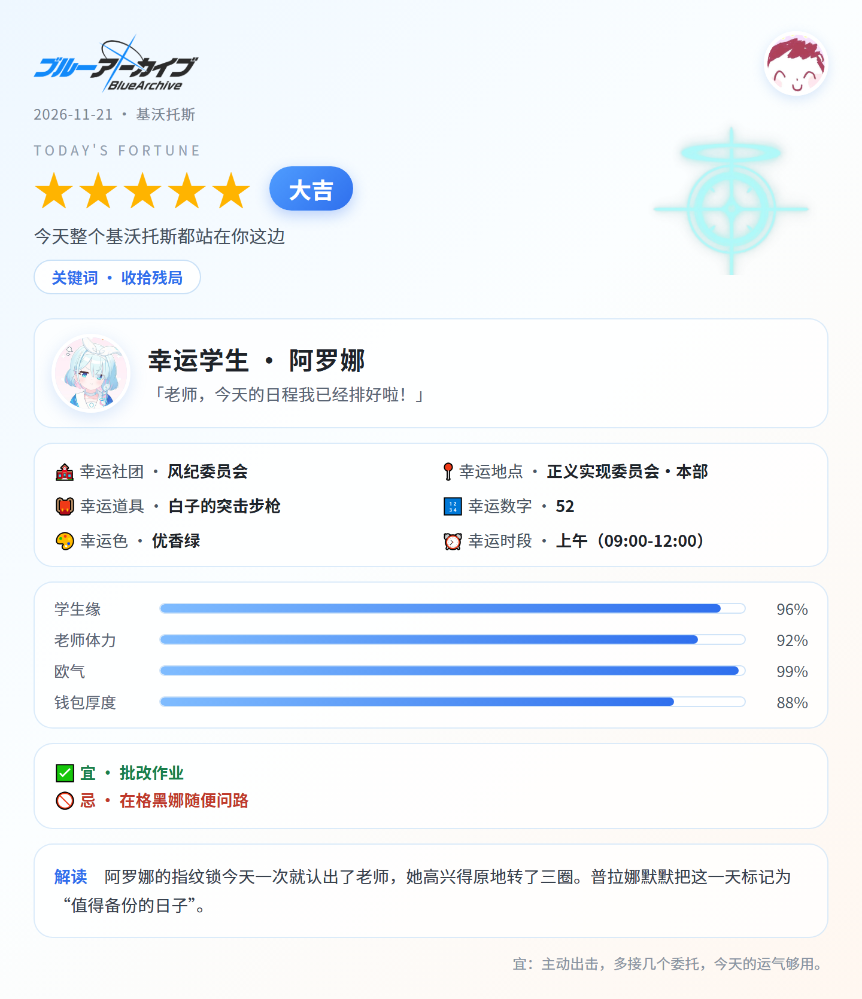
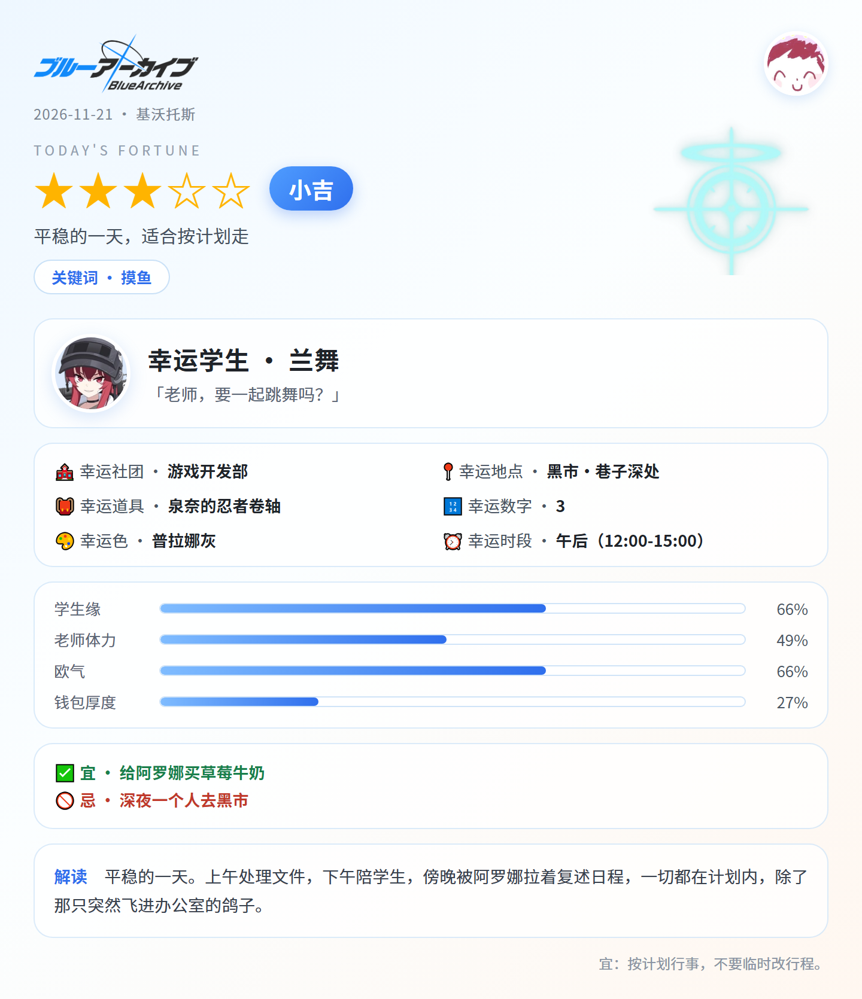
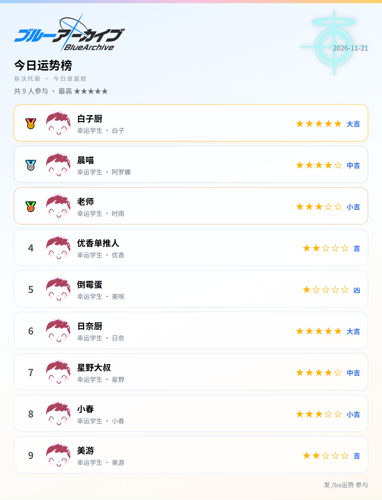

# BA 运势

)

碧蓝档案（Blue Archive）主题的每日运势。抽一次，得到一张专属运势卡片。

- 122 位学生随机出镜，全部带头像与专属台词
- 1~5 星 → 大吉 / 中吉 / 小吉 / 吉 / 凶
- 动态渲染专属卡片 + 今日运势榜
- 每人每天 1 次，零点清零

## 预览

**运势卡片（大吉 · 五星）**



**运势卡片（中吉 · 四星）**



**今日运势榜**



## 安装

### 方式一：插件市场

在 AstrBot 面板「插件市场」搜索 **BA 运势** 安装。

### 方式二：手动上传

1. 下载本仓库（或 Release 里的 zip）
2. 把整个目录放到 `AstrBot/data/plugins/` 下
3. 安装依赖：

```bash
pip install -r requirements.txt
playwright install chromium
```

4. 重启 AstrBot

> 需要 `playwright` 和 Chromium 才能渲染图片；没装的话会自动回退成文字。

## 指令

| 指令 | 说明 |
|---|---|
| `/ba运势` | 抽今日运势，返回图片卡片 |
| `/ba运势榜` | 看本群今日运势榜（图片，前 15 名） |

`ba` 大小写都认：`/BA运势`、`/Ba运势` 都可以。

## 玩法

### 1. 星级判定

| 星级 | 判定 | 概率 |
|---|---|---|
| ★★★★★ | 大吉 | 20% |
| ★★★★ | 中吉 | 30% |
| ★★★ | 小吉 | 25% |
| ★★ | 吉 | 17% |
| ★ | 凶 | 8% |

### 2. 卡片包含

- 幸运学生（**122 位**，全部带头像与专属台词）
- 幸运社团 / 地点 / 道具 / 数字 / 幸运色 / 幸运时段
- 今日关键词
- 四项运气条：学生缘、老师体力、欧气、钱包厚度
- 宜 / 忌（基沃托斯版）
- 解读小故事 + 建议
- 大吉时额外一句阿罗娜的偏爱

### 3. 运势榜

- 只统计**本群**
- 按星级排序，同星按抽取时间
- 最多显示 **15 名**，前三名金银铜描边
- 每行显示玩家自己的头像 + 昵称 + 星级 + 判定 + 幸运学生

### 4. 次数限制

- 每人每天 **1 次**
- **零点清零**（北京时间的 00:00，由后台任务与日期校验双重保证）

## 学生数据

学生名单与头像来自 [SchaleDB](https://schaledb.com)：

```
https://schaledb.com/data/cn/students.min.json     ← 中文简称 + ID
https://schaledb.com/images/student/icon/{Id}.webp ← 头像
```

- 学生名统一使用 SchaleDB 中文简称（白子、日奈、爱露……）
- 头像打包在 `assets/students.zip` 内，运行时直接读取，**离线可用**
- 开发时可放散装 `assets/students/<学生名>.png`，优先于 zip
- 阿罗娜、普拉娜等非卡池角色使用手动提供的素材

## 视觉

- 整体为浅蓝→白→暖白渐变 + 毛玻璃面板
- 顶部为官方 wordmark（`assets/logo.png`）
- 右上角为 SCHALE 青色徽记（`assets/schale.png`，去辉光的线稿版本）
- 右上角头像为**用户自己的头像**：
  - QQ 官方 bot：`q.qlogo.cn/qqapp/{appid}/{openid}/0`
  - NapCat 等：`q1.qlogo.cn/g?b=qq&nk={QQ号}&s=100`
  - 都取不到 → `assets/user.png` 兜底

## 配置

| 配置项 | 默认 | 说明 |
|---|---|---|
| `dynamic_card` | true | 开=动态渲染卡片；关=固定图 + 文字 |
| `daily_limit` | 1 | 每人每天次数，0 为不限 |
| `show_stars` | true | 文字版是否显示星级 |
| `images_dir` | 空 | 关闭动态卡片时使用的图片目录 |

## 目录结构

```
astrbot_plugin_ba_fortune/
├── main.py                 插件主体
├── logo.png                插件列表图标
├── metadata.yaml
├── _conf_schema.json
├── README.md
└── assets/
    ├── logo.png            卡片/榜单用的官方 wordmark（已裁边）
    ├── logo.svg            原始 SVG
    ├── schale.png          SCHALE 徽记（透明线稿）
    ├── user.png            用户头像兜底
    ├── bg.png              可选：卡片背景（不存在则用渐变）
    └── students.zip        122 张学生头像（单文件分发）
```

## 数据文件

```
data/plugin_data/astrbot_plugin_ba_fortune/daily.json
```

结构：

```json
{
  "date": "2026-11-21",
  "users": {
    "<群openid>:<用户openid>": {
      "n": 1,
      "name": "晨喵",
      "star": 4,
      "verdict": "中吉",
      "student": "日奈",
      "ts": "2026-11-21T01:52:00",
      "avatar": "https://..."
    }
  }
}
```

删掉这个文件即可让所有人重新抽一次。

## 依赖

- `playwright`（+ Chromium）：渲染卡片与榜单
- `aiohttp`：下载头像
- `Pillow`：素材处理（仅制作素材时使用）

渲染失败会自动回退：卡片回退成「固定图 + 文字」，榜单回退成文字榜。

## 常见问题

**Q：为什么头像不是我的？**
官方 bot 只能拿到 openid，若 `appid` 解析失败会用兜底老师头像。

**Q：为什么抽不到某个学生？**
名单是 122 位，含部分联动角色；没有的角色可以在 `STUDENT_LINES` 里自行添加。

**Q：能改概率吗？**
改 `STAR_WEIGHTS = [8, 17, 25, 30, 20]`（对应 1~5 星权重）。

**Q：卡片太大？**
约 600 KB / 张。可以调低 `_render_card` 里的 `device_scale_factor`。
